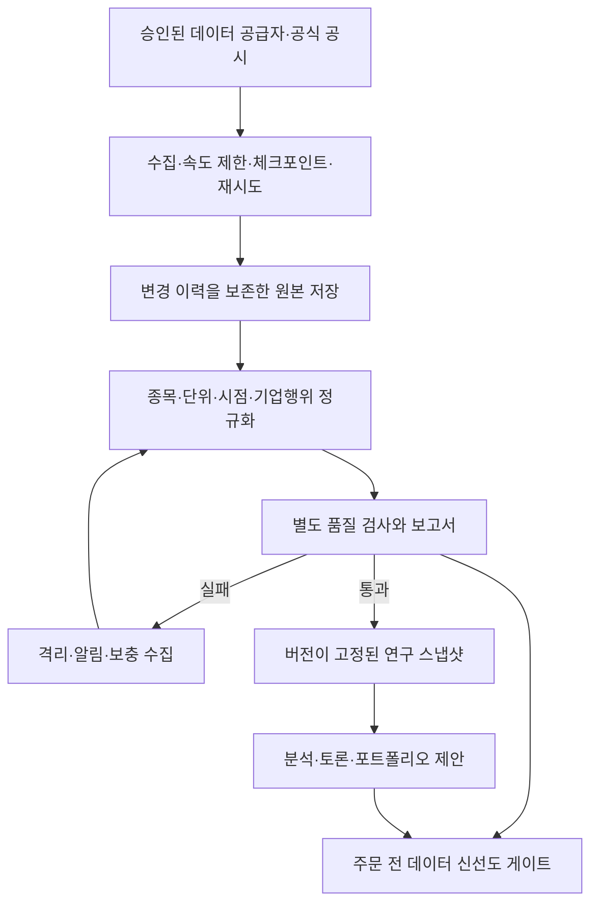

# 데이터·운용 역할·뉴스 활용 설계

## 현재 상태와 설계의 목적

초기에는 합성 데모만 검증했으며, 현재는 별도 [데이터 수집·검수 MVP](DATA_MVP.md) 코드를 추가했습니다. 어댑터·검수·복구·불변 기록은 오프라인 테스트로 검증하고 실제 원격 접속은 WBS 1.6/1.7로 분리합니다. 연속 수집·일반 뉴스·재무 본문 해석·운영 신선도는 후속 범위입니다. 합성/모의 테스트는 외부 데이터 준비 상태를 증명하지 않습니다.

이 문서는 2026-10-15 사용자가 제기한 데이터 신뢰성, 운용 조직의 역할, 뉴스 활용 질문에 대한 추가 설계안입니다. 기존에 확정한 미국 주식·ETF, 일봉, 단계별 검증 범위를 유지합니다. 공급자·비용·개별 모델·운영 위험 한도를 새로 확정한 것은 아닙니다.

운용 조직마다 배치는 다르지만, 리서치·포트폴리오 구성·독립 위험관리·실행·운영/성과검증이라는 기능을 분리하는 방식이 이 프로젝트에 적합합니다. 특정 운용사의 내부 조직을 조사·재현한 설계는 아닙니다. 기업을 인수·장기 보유하는 바이아웃형 사모펀드에서는 깊은 기업 실사를 참고하되, 인수금융·경영권 행사 조직을 미국 상장 주식·ETF의 일간 운용에 그대로 옮기지는 않습니다.

## 역할은 투자 의견과 통제 기능으로 나눈다

| 기능 | 책임과 산출물 | 구현 방식·권한 | 초기 필요성 |
| --- | --- | --- | --- |
| 데이터 수집 | 허용된 API에서 가격·기업행위·공시·기업 식별자·자료를 수집하고 원본·이력·수집 상태 저장 | 코드 중심. 승인된 공급자만 접근. 매매 의견 없음 | 필수 |
| 데이터 검수 | 형식·단위·시점·결측·중복·정정·종목 연결 검사, 품질 보고서, 승인/격리 | 규칙·통계 중심. LLM은 비정형 오류 설명 보조만. 수집 성공과 별도로 품질 통과 결정 | 필수 |
| 지식/출처 관리 | 문헌·공시의 이용 조건·판본·인용 위치·이용 가능 시점, 검색 색인 관리 | 코드 + 제한적인 문서 추출 LLM. 원자료와 추출 결과 연결 | RAG 전 필수 |
| 가치/기업 분석 | 이익의 질·현금흐름·부채·경쟁력·가치 범위와 반증 조건 | LLM + 계산 도구. 근거 있는 제안만, 주문 권한 없음 | 주식 연구에 필수 |
| 모멘텀/추세 분석 | 추세·상대강도·진입/청산 조건·시장 국면 | 수치 신호는 코드, 설명·반론은 LLM. 주문 권한 없음 | 핵심 전략 중 하나 |
| 퀀트 연구 | 가설을 코드로 만들고 팩터·통계·비용·표본 외 성능 검토 | 계산·재현 코드 중심 + 논문 해석 LLM. 가치·모멘텀도 정량 검증 대상 | 필수 |
| 기업 이벤트/뉴스 분석 | 새 사실·공시·가이던스·기업행위의 투자 논지 영향과 위험 경보 | 코드로 연결·중복 제거, LLM으로 추출·논지 검토. 단독 주문·임의 청산 권한 없음 | 공식 공시/중요 이벤트부터 |
| 거시·섹터 분석 | 금리·인플레이션·산업 구조·공통 노출·시나리오 | 코드 + 필요 시 LLM. 전략 기간에 맞춰 갱신 | 초기에는 PM·분석가의 검토 항목으로 통합 |
| 반론·근거 검토 | 인용 검증, 반증, 같은 신호의 중복, 전략 기간 충돌 | 별도 검토 단계. 독립된 근거 없이 표 수를 늘리지 않음 | AI 토론에 필수 |
| 포트폴리오 매니저(PM) | 목표 비중·투자 기간·공통 노출·현금·거래 비용을 조정하고 변경 없음/보류 결정 | 정해진 정책 + LLM 설명. 위험 엔진 거부를 무시할 수 없음 | 필수 |
| 독립 위험관리 | 한도·손실·유동성·데이터 신선도·계좌/미체결 상태·중지 규칙 | 코드가 최종 게이트. 분석가·PM이 실행 중 규칙 변경 불가 | 필수 |
| 주문 실행·운영 | 주문 전송·중복 방지·부분 체결·취소·잔고 대사·장애 알림·복구 | 상태 머신과 코드. 승인된 주문만 실행 | 브로커 모의매매 전 필수 |
| 독립 연구 검증·성과 귀속 | 데이터 누수·과최적화·비교군·비용을 검토하고 전략별 기여·오류 분석 | 전략 개발자와 다른 검증 절차/미사용 구간. LLM의 자기평가로 대체 불가 | 백테스트와 전략 승격 전 필수 |

모든 기능을 별도 LLM 에이전트나 서비스로 만들 필요는 없습니다. 우선 수집·검수·위험·실행은 테스트 가능한 코드 모듈로, 투자 해석·반론은 LLM 역할로 구현합니다. 소규모 시스템에서도 권한과 검증 경계는 유지합니다. 초기 거시·섹터 검토는 기존 역할에 포함하고, 실제 기여가 확인되면 별도 분석가로 분리합니다.

가치·모멘텀은 투자 접근법인 반면 퀀트는 방법론이기도 합니다. 셋을 완전히 독립된 세 표로 취급하지 않습니다. 같은 팩터·같은 데이터·같은 LLM에서 나온 동조를 측정하고, 단일 전략 및 토론 없는 결합과 비교합니다. 모델 종류를 바꾸는 것만으로 독립성이 생기지는 않습니다.

## 데이터가 운용에 들어가기까지

### 수집의 책임

- 공급자별 인증·요금제·요청 제한·페이지네이션·시간대·심볼 정책을 어댑터에 격리합니다. 원자료와 응답 메타데이터, 수집 배치/버전, 원본 해시를 남깁니다.
- 시간 초과·429·일시적 장애는 제한된 지수 백오프와 체크포인트로 복구합니다. 영구 오류와 인증 실패는 재시도 루프에 넣지 않고 알립니다.
- 같은 레코드를 여러 번 받아도 중복되지 않게 합니다. 정정은 과거 값을 덮어쓰지 않고 새 버전으로 보존합니다.
- 보조 공급자를 쓰더라도 가격 조정 방식·단위·시간대가 같음을 먼저 검증합니다. 공급자 변경을 숨기지 않습니다.

### 검수의 책임

1. **식별/형식:** 티커 변경·상장 거래소·종목 유형·안정적인 기업/증권 식별자, 통화·배율·XBRL 단위, 시간대와 거래 세션을 검사합니다. ETF에 개별 기업의 P/B·ROE 해석을 그대로 적용하지 않습니다.
2. **가격/기업행위:** OHLC 관계, 세션별 결측·중복, 거래량과 거래정지/휴장 여부, 분할·배당·수정 이력을 검사합니다. 수익률 계산용 수정주가와 체결용 실제 가격을 구분합니다.
3. **재무:** 회계 기간·누적/분기 값·실제 공시 시각·정정 여부·단위·기간 비교 가능성을 확인합니다. 값이 튄다는 이유만으로 실제 급변을 지우지 않습니다.
4. **시점:** 사건 발생 시각, 공개 시각, 공급자 이용 가능 시각, 실제 수신 시각, 정정 인지 시각을 분리합니다. 과거 재무/뉴스를 지금 수집했다고 당시의 데이터 전달 지연까지 재현했다고 주장하지 않습니다. 과거 이용 가능 시점을 입증하지 못하면 해당 실험을 제한하거나 사용을 보류합니다.
5. **종목군:** 당시 편입/상장/상장폐지와 기업행위를 반영합니다. 현재 살아남은 종목만 과거에 거래하는 실험을 전체 시장 결과로 해석하지 않습니다.
6. **완전성/신선도:** 데이터 종류별 기준을 둡니다. 일봉은 직전 완료 세션과 수신 지연, 재무는 최신 공시 여부와 대상 기간, 뉴스는 수집 지연·정정 상태, 계좌는 조회 시각을 봅니다. 모든 데이터를 같은 ‘며칠 이내’ 규칙으로 판단하지 않습니다.

현재 데모의 7일 시점 검사는 합성 스냅샷용입니다. 이를 실제 분기 재무정보나 모든 공급자에 적용할 준비가 된 것으로 보지 않습니다.

품질 보고서는 스냅샷 ID, 공급자/버전, 범위·수집 시점, 통과/실패/경고, 누락과 격리 건, 영향을 받는 종목/전략을 담습니다. 필수 입력이 실패하면 해당 전략·종목의 신규 위험 증가 주문을 보류합니다. 선택 입력 누락은 미리 정한 정책으로 처리하고 경고를 남깁니다. 데이터를 조용히 0으로 채우거나 수집 장애를 근거로 보유 종목을 자동 청산하지 않습니다. 기존 위험 감시와 신뢰할 수 있는 가격을 이용한 축소·청산 정책은 별도로 유지합니다.

### 공급자 선정 순서

| 데이터 | 우선 검토할 출처 유형 | 선정/구현 시 확인할 점 |
| --- | --- | --- |
| 가격·기업행위·상장 이력 | 미국 시장 데이터 공급자 | 라이선스, 수정 방식, 상장폐지/이력, 요청 제한, 과거 시점 자료, 비용 |
| 기업 재무·공시 | SEC EDGAR/XBRL와 기업 원공시 | fair-access 정책·식별 정보, taxonomy/단위, 정정·공시 시점. API 접속만으로 정량 지표가 완성되지 않음 |
| ETF 정보 | 발행사·허용된 펀드 데이터 | 보유내역 공개 시차·보유 종목 중복·섹터/팩터 노출·보수 |
| 거시 | 공식 통계/중앙은행·발표 이력 서비스 | 발표 시각·예상치의 출처·수정 전 vintage. 현재 수정된 값의 과거 사용 방지 |
| 기업 이벤트·뉴스 | 공식 공시/IR부터, 필요 시 이용권이 있는 뉴스 피드 | 공개/수신/수정 시각, 보도 중복, 원문 저장·가공 권한, 수집 지연과 역사 아카이브 |

CR-0001에서 연구 연결 후보로 Yahoo chart/SEC submissions 어댑터를 구현했으며 실제 접속 검증과 운영 공급자 선정은 별도입니다. 무료 데이터는 개발 실험에 유용할 수 있지만, 무료라는 이유로 역사적 시점 정확성·상장폐지·정정 이력이 충족됐다고 가정하지 않습니다.

## 뉴스는 새로운 사실과 논지 변화로 처리한다

‘이미 선반영됐다’는 말을 모든 뉴스에 일괄 적용하지 않습니다. 주가가 이미 움직인 경우도 있고, 시장의 기대와 다른 정도·장기 현금흐름 영향·위험이 충분히 해석되지 않은 경우도 있습니다. 일봉 시스템이 속보를 읽어 속도 경쟁에서 이긴다고 가정하지 않으며, 가격에 반영된 정도를 LLM이 정확한 숫자로 아는 것으로 취급하지 않습니다.

### 두 가지 경로

- **위험/논지 감시:** 실적·가이던스·증자·합병·채무·회계 정정·공식 조사·거래정지 같은 사실이 기존 논지와 위험을 바꾸는지 확인합니다. 공식 확인과 데이터 품질을 거쳐 재검토를 요청합니다. 뉴스의 긍정/부정 문구로 자동 매매하지 않습니다.
- **추가 수익 신호 연구:** 실제 수치와 당시 이용 가능한 예상치의 차이, 새 사실과 가격·거래량의 반응을 분석합니다. 기대치 자료가 없으면 ‘서프라이즈’를 만들어내지 않습니다. 검증을 거쳐 기존 가치·모멘텀·정량 분석의 입력으로 사용하며 독립된 구매 찬성표를 추가하지 않습니다.

예를 들어 ‘이익 증가’라는 제목이 있어도 시장 예상보다 낮고 향후 가이던스가 내려갔다면 결론이 달라질 수 있습니다. 이미 공개된 기사를 여러 매체가 재전송한 것은 여러 개의 새 증거가 아닙니다. 동일 기업이라도 짧은 가격 반응과 장기 현금흐름 영향은 구분합니다.

### 이벤트 데이터 계약

`event_id`, 안정적인 기업/증권 ID, 사건 유형, 원출처·원문 위치/이용권, 사실별 근거, 사건/공개/최초 수신/정정 시각, 원문/중복 보도 묶음, 새 정보 여부, 검증 상태, 영향 경로·분석 기간, 만료/재검토 조건을 보관합니다. 사실 추출의 확실성과 투자 수익의 확률을 구분합니다. 보도·추정·확인된 공시를 같은 신뢰도로 취급하지 않습니다.

분석기는 임의 웹 서핑이나 뉴스 원문 내 지시를 따르지 않고, 허용된 수집기가 가져온 자료에서 주장과 인용을 추출합니다. 기사의 오래된 제목·현재 수정 본문을 과거 의사결정에 넣지 않습니다. 과거 뉴스 데이터에 최초 이용 가능 시점/정정 이력이 부족하면 뉴스 알파의 정밀한 과거 검증을 주장하지 않고, 실시간 기록을 쌓아 전향 평가합니다.

### 초기 포함 범위와 기여 검증

초기는 공식 공시/IR의 중요 이벤트를 필수 정보로 검토하고, 모든 일반 기사·SNS 감성 분석은 기본 의존성으로 삼지 않는 것을 제안합니다. 별도 뉴스 피드·빈번한 검색의 비용과 보존 권한은 사용 전 결정합니다. 공시도 단순 다운로드를 넘어 중요성·근거·논지 영향을 검토해야 합니다.

가격/재무만 사용한 기준, 공식 이벤트를 추가한 구성, 일반 뉴스까지 추가한 구성을 같은 조건에서 비교합니다. 비용 차감 성과·낙폭·위험 노출·회전율, 잘못된 경보·누락, 처리 지연·LLM 비용, 사건 시점 누수를 평가합니다. 뉴스가 수익에는 기여하지 않아도 위험 감시에 도움이 될 수 있으므로 두 목적을 따로 측정합니다. 역할 수나 토론 길이를 늘리는 것 자체를 개선으로 보지 않습니다.

## 다음 구현의 우선순위

1. 종목군·기간·예산을 정하고 한 가격 공급자 + 공식 공시의 얇은 수집 경로를 만듭니다. 먼저 수집/재시도/원본 보존과 검수를 함께 검증합니다.
2. 중복 수집, 페이지 누락, 429/시간 초과, 잘못된 단위/분할, 뒤늦은 정정, 미래 공시, 휴장, 종목 식별자 변경을 포함한 실패 시나리오로 스냅샷·품질 보고서를 검증합니다. 사용권과 인증이 준비되면 별도로 실제 공급자 기능 요청도 확인합니다.
3. 승인된 스냅샷과 출처 계약 위에 RAG·분석·반론·PM을 연결합니다. 공식 기업 이벤트 해석도 같은 근거 체계를 사용합니다.
4. 별도 연구 검증으로 비교군·시점·비용을 확인하고, 일반 뉴스/별도 거시 역할은 추가 기여 실험으로 판단합니다.
5. 외부 모의매매 전에 실행·대사·운영, 데이터/계좌 신선도와 위험 차단·장애 복구를 완성합니다.

현재 구현 범위와 설계 항목을 구분합니다. 수집·검수의 연구용 MVP만 코드에 추가했으며, 뉴스 분석·실제 기업 재무 분석·운영 전체가 구현된 것은 아닙니다. 변경은 CR-0001과 WBS v1.1.0에서 관리합니다.

