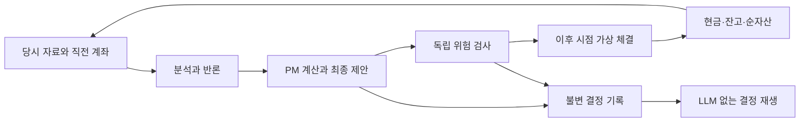

# 포트폴리오 이론 담당과 최종 결정 백테스트 설계

계획 v1.4.0 / [CR-0004](changes/CR-0004.md), 2026-10-19 (한국 시간). **설계 요구사항이며 미구현입니다.** 현재 `research.py`의 합성 규칙·단순 평균과 1회 가상 매수는 이 설계의 역사적 백테스트가 아닙니다.

## 포트폴리오 매니저/포트폴리오 이론 담당

PM은 가치·모멘텀·퀀트의 근거와 반론을 받아 **전체 계좌의 목표 비중**을 제안하는 명시적 역할입니다. 종목의 투자 논지를 검증하는 퀀트 연구자와 협력하되, 여러 종목을 함께 보유할 때 생기는 위험과 배분을 책임집니다. PM의 설명은 LLM이 담당하고 통계·노출·최적화·제약 검증은 버전이 있는 계산 코드로 수행합니다. PM은 독립 위험 엔진의 한도·거부·실행 권한을 바꿀 수 없습니다.

| 책임 | 입력·산출물 | 실패·한계 처리 |
| --- | --- | --- |
| 분산과 중복 노출 | 종목 간 상관·공분산, 종목/섹터/팩터 집중, ETF와 직접 보유의 중복 | 당시 이용 가능했던 구성종목·분류·팩터 자료만 사용. 누락 시 완전한 분산을 주장하지 않고 적용 불가·보류 범위를 기록 |
| 위험 예산 | 예상 변동성, 종목별 위험 기여도, 집중·상관 급등 시나리오 | 추정 위험과 실현 위험을 구분. 예상 변동성으로 최대낙폭을 보장하지 않음 |
| 목표 비중 | 현재 보유·현금, 투자 기간, 검증된 신호, 제약·회전율·거래 비용 | 현금 포함 전체 목표를 출력. 제약 불충족·최적화 실패를 임의 정규화로 숨기지 않음 |
| 의사결정 설명 | 채택/기각 의견, 반론, 배분 전후 위험·노출·예상 비용, 재검토 조건 | 신뢰도 점수를 수익 확률·기대수익률로 치환하지 않음 |

통계 입력은 `information_cutoff`까지 이용 가능한 과거 수익률만 사용합니다. 추정 기간, 최소 공통 관측 수, 빈도·연율화, 결측·신규 상장·이상치 정책, 공분산 축소 추정 방식과 양의 준정부호 검사를 실험 전에 고정합니다. 미래 가격으로 기간을 채우거나 결측 수익률을 0으로 만들지 않습니다. 따로 추정한 상관계수를 조합해 유효하지 않은 행렬을 만들지 않습니다.

같은 통화·빈도의 공분산 `Σ`와 자산 비중 `w`에서 예상 변동성은 `σp = sqrt(wᵀΣw)`, 변동성 위험 기여도는 `RCᵢ = wᵢ(Σw)ᵢ / σp`로 계산합니다. `ΣRCᵢ = σp`를 확인하고, 음의 기여와 `σp = 0`인 경우를 명시적으로 처리합니다. 현금 수익률·위험 가정과 ETF 기초자산 노출 계산은 별도 메타데이터로 남깁니다.

배분 정책은 다음처럼 비교 가능하게 분리합니다. 모든 정책의 제약·입력 변환·하이퍼파라미터는 훈련/검증 구간에서 정하고 최종 미사용 구간 전에 고정합니다.

- **고정 결합/균등 배분:** 분석 제안을 결합하는 사전 규칙과 공통 한도를 적용하는 기준군.
- **최소분산·리스크 패리티:** 기대수익률 추정이 없어도 평가할 수 있는 위험 중심 후보. 특정 자료에서의 수치적 안정성과 집중 위험을 검증함.
- **평균–분산:** 같은 투자 기간으로 보정하고 별도 검증한 기대수익률 추정이 있을 때만 사용. LLM의 낙관적 문장·신뢰도·제안 비중을 기대수익률로 간주하지 않음.

초기에는 공매도·레버리지 없이 `자산 비중 합 + 현금 비중 = 1`을 만족해야 합니다. 종목·총노출·현금·회전율 등은 기존 연구 한도를 출발점으로 삼고, 섹터·팩터·상관·유동성·손실 한도의 숫자와 후보 정책은 해당 단계에서 결정합니다. 계산에 필요한 자료가 없거나 제약 해가 없으면 `defer`와 이유를 출력하고 새 재량 주문을 만들지 않습니다. 기존 보유·현금·미체결 상태는 유지·기록하며 별도로 승인된 위험 축소 정책이 있다면 독립 위험 경로로 처리합니다. 실패 시 자동 전량 현금화하지 않습니다.

공개 원문과 직접 정리한 원칙을 RAG에 연결할 때 평균–분산, 추정 오차·공분산 축소, 위험 기여도/위험 예산을 문헌 범위에 포함합니다. 기존 WBS 2.1의 출처 계약을 사용하고 WBS 3.3의 문헌 확장에서 실제 판본·이용 조건·시점·인용 위치를 확인합니다. 특정 문헌을 이미 확보·학습·검증했다고 주장하지 않습니다.

## 회의 최종 의견을 실행 가능한 결정으로 남기는 계약

`decision_id`로 각 분석 초안 → 반론 → PM의 최종 제안 → 위험 판정 → 주문 → 체결 → 계좌 평가를 연결합니다. 자연어 회의록만으로 매수·매도를 추론하지 않습니다. 다음은 후속 구현의 계약이며 현재 Pydantic 스키마가 아닙니다.

| 기록 | 필수 내용 |
| --- | --- |
| 실험 정의 | `experiment_id`, 코드/모델/프롬프트/검색/계산 버전, 정책·파라미터·예산, 종목군·벤치마크·기간·분할·일정·비용·현금 수익 가정 |
| 의사결정 입력 | `decision_id`, `decision_time`, 자료의 이용 가능 마감 `information_cutoff`, 시장/지식/계좌/통계 스냅샷 ID·해시, 이전 계좌 상태 ID, 근거·초안·반론·원응답 |
| PM 최종 제안 | `action = rebalance / hold / defer`, 자산별 전체 `target_weights`와 `cash_weight`(rebalance 필수), 기준 계좌 상태 ID, 투자 기간·재검토 시점, 채택/기각 이유, 계산 결과·예상 비용·실패 이유 |
| 위험 판정·실행 결정 | `approved / rejected / no_order`, 위험 정책 버전, PM 제안 해시, 검사 이유, 승인된 목표/주문 ID, `earliest_execution_at`·주문 만료 조건 |
| 결과 | 주문/체결/취소/미체결·지연 사유, 수량·가격·비용·현금·잔고·순자산, 계좌 상태 ID, 평가 시각·가격 출처·품질, 호출 비용·소요 시간 |

모든 시점은 시간대가 있는 값으로 보관합니다. `information_cutoff <= decision_time < earliest_execution_at`을 보장하고 주문은 결과 생성·검사 완료 뒤에만 실행합니다. 일봉 마감 자료로 판단하면 다음 실행 가능한 거래 시점 이후의 가격을 사용하며, LLM 지연 때문에 다음 시가를 놓치면 그 이후로 넘깁니다. 미래 실행 봉은 분석/PM 입력에 포함하지 않습니다.

`rebalance`의 목표는 거래 허용 종목과 기존 보유를 모두 포함합니다. 0은 청산 의도이며 누락은 자동 청산으로 해석하지 않고 스키마 오류로 처리합니다. 정수 수량·비용·미체결 때문에 실제 비중은 목표와 다를 수 있으므로 별도로 기록합니다. `hold`는 현재 수량을 유지하는 결정이지 이전 목표 비중으로 다시 리밸런싱하는 명령이 아닙니다. `defer`, 위험 거부, 호출/파싱 실패도 결정을 남기고 새 재량 주문을 만들지 않습니다. 기존 미체결 주문의 유지/취소·만료 정책은 실험에 고정하고 자금 예약을 계좌에 반영합니다.

## 두 가지 평가 모드

| 모드 | 동작 | 해석 |
| --- | --- | --- |
| 과거 시점별 전체 의사결정 생성 | 각 시점의 자료·이전 가상 계좌만 공개하고 분석 → 토론 → PM → 위험 → 가상 체결 → 다음 계좌를 순차 실행. 원응답과 결정을 불변 저장 | 전체 파이프라인의 과거 시뮬레이션. 최신 LLM이 미래 사건을 알고 있을 수 있으므로 오염 가능성을 별도 보고 |
| 저장된 결정 오프라인 재생 | LLM/외부 네트워크 없이 고정된 결정·위험 정책·실행 자료·초기 계좌로 회계와 체결을 재계산 | 동일 입력의 체결·현금·순자산·판정 이유가 같아야 함. 과거 정보만으로 최초 결정을 만들었다는 증거를 대신하지 않음 |

LLM을 다시 호출하면 별도 생성 실험으로 분리하고 같은 결정의 재생이라고 부르지 않습니다. 기본 재생은 원래 결정이 기대한 직전 계좌 상태 ID·해시를 검사합니다. 초기 자본·비용·체결 정책을 바꿔 계좌가 달라지면 원래의 계좌 의존적 결정을 그대로 타당하다고 가정하지 않습니다. 이 경우 별도 민감도 실험으로 표시하고 상태 불일치와 적용 한계를 기록하거나 전체 결정을 새로 생성합니다. 저장된 위험 판정은 재계산 결과와 대조하며 정책 변경은 새 실험으로 구분합니다.

초기 자본을 시점마다 재설정하지 않습니다. 매수·매도, 비용·배당·분할·상장폐지, 현금 수익 가정, 거래정지·결측 가격·미체결·부분 체결을 연속 장부에 반영합니다. 신뢰할 수 있는 평가 가격이 없으면 이전 가격 사용 여부와 경과 시간을 표시하고 해당 기간의 성과 신뢰도를 제한합니다. 수익이 난 체결만 고르거나 실패일을 분모에서 빼지 않습니다.

## 비교 실험과 성과 보고

동일한 당시 종목군·기간·초기 자본·정보 마감·거래 일정·실행/비용 모델·위험 한도를 적용합니다. 각 실험은 자기 체결에 따른 계좌를 이어갑니다. 아래 4개 군은 입력 의견의 형식과 결합 규칙을 고정해 토론과 PM의 기여 및 상호작용을 구분합니다.

| 실험 | 토론 | 포트폴리오 배분 |
| --- | --- | --- |
| A | 독립 초안만 | 고정 결합 정책 |
| B | 반론 후 최종 분석 의견 | A와 같은 고정 결합 정책 |
| C | 독립 초안만 | 사전 고정한 PM 정책 |
| D | 반론 후 최종 분석 의견 | C와 같은 PM 정책 — 회의 최종 결정 전체 |

별도로 현금·동일 종목군의 단순 보유·고정 리밸런싱·각 단일 전략을 비교합니다. 뉴스·배분 알고리즘·모델 변경은 각각 새 실험 ID로 분리합니다. 자료 누락·실패·보류·위험 거부·미체결·한도 위반 횟수와 전체 예정 의사결정 수를 함께 보고합니다. D가 다른 군보다 좋다는 가정으로 결과를 선택하지 않습니다.

연속 순자산에서 누적/연율 수익률, 변동성, Sharpe/Sortino의 무위험 수익·빈도 가정, 최대낙폭·회복기간, 회전율·거래 비용, 현금·종목/섹터/팩터 노출, 예상/실현 위험·위험 기여도를 보고합니다. 거래비용 차감 투자 성과와 LLM/데이터 비용을 표시하고, 실제 투자금 규모에서 연구·운영비까지 차감한 경제성은 별도 보고합니다. 적중률은 보조 지표이며 의사결정 시스템의 성과를 대체하지 않습니다.

훈련/검증/최종 미사용 구간과 walk-forward 창을 미리 정합니다. 공분산·기대수익·신호 보정·정책 선택에 사용한 자료의 마지막 이용 가능 시점이 각 결정 마감 이하여야 합니다. 미래 가격을 바꾸어도 과거 입력·PM 제안이 바뀌지 않는지 검증합니다. LLM 실험은 모델 ID·호출 설정·응답·반복 횟수·모든 시도 비용을 남기고 여러 실행의 분산을 보고하며 가장 좋은 실행만 고르지 않습니다.

역사적 LLM 지식 오염은 시점 필터·익명화·미래 사건 언급 검사만으로 제거됐다고 주장하지 않습니다. 결정 재생의 재현성, 과거 정보 시점 적합성, LLM 전향 성과를 구분하고, 최종 전략 승격에는 별도 전향 모의 관찰을 요구합니다. 수익·위험·품질 승격 기준은 결과를 보기 전에 정하며 아직 숫자를 확정하지 않았습니다.

## 후속 구현 완료 조건

| WBS | 필수 검증 |
| --- | --- |
| 3.3 문헌 확장 | 포트폴리오 이론 원문의 실제 이용 조건·판본·시점·인용과 적용 한계 확보 |
| 3.3 | PM 역할/계산 경계·정책 버전·제약 검증, 상관/중복 노출·위험 기여, 관측 부족·공분산 오류·최적화 불능·예산 초과 시 보류, 구조화된 최종 제안 |
| 3.4–3.5 | 제안/위험 결정 분리, 한도 우회·미래 입력 차단, hold/defer/오류 시 주문 없음, 깨진 JSON·시간 초과·누락 목표 처리 |
| 4.1 | 추정 구간·당시 종목군·공시·ETF/섹터 정보의 이용 가능 시점, 기업행위·상장폐지·결측 정책 확인 |
| 4.2 | 전체 결정 생성/저장/재생·계좌 상태 일치, 다음 가능 시점 체결·매수/매도·정수 수량·현금·비용·기업행위·미체결·부분 체결, 결정부터 순자산까지 추적 |
| 4.3 | A/B/C/D 및 기준 전략의 공통 조건 비교, 실패 포함 전체 결정, 비용·노출·위험 기여·경제성 보고 |
| 4.4 | 동일 입력 재생 일치, 계좌 불일치 감지, 미래 데이터 변경 불변성, walk-forward/최종 미사용 구간·반복 실행·누수/오염 한계 보고 |
| 4.5 | 위 근거와 사전 고정 승격 기준·잔여 제한을 확인한 뒤 모의매매 진입 판단 |

문서 설계나 합성 테스트 통과만으로 이 완료 조건을 충족한 것으로 표시하지 않습니다. 실제 백테스트 구현과 검증은 데이터·지식·AI 단계의 선행 게이트를 따른 뒤 수행합니다.

기존 데이터·지식 게이트의 완료 기록은 유지합니다. 이번 포트폴리오 이론 문헌 확장은 WBS 3.3의 후속 완료 조건이며 기존 2.1 완료가 해당 문헌의 확보를 입증하지는 않습니다. 지표 원천과 Agent 패킷은 [지표·데이터 설계](INDICATOR_DATA_DESIGN.md)의 1.9–1.19 선행 조건을 따릅니다.
