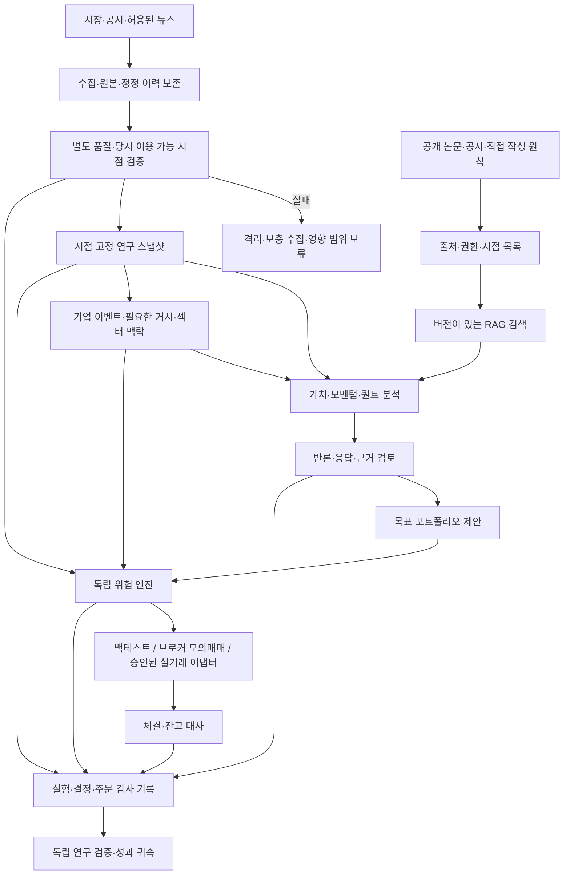

# 프로젝트 계획

## 제품 목표와 첫 범위

미국 주식·ETF의 일봉과 공개된 기업정보를 바탕으로, 가치·모멘텀·퀀트 관점의 AI가 서로 검토하여 목표 포트폴리오를 제안합니다. 별도 위험 엔진이 허용한 변경만 실행하고, 자료·토론·결정·체결을 연결해 나중에 설명하고 재현할 수 있게 합니다. 개발 순서는 연구/백테스트, 브로커 모의매매, 제한적인 실거래입니다.

이번 초기 구성은 개발 기반과 **한 번의 합성 데이터 시뮬레이션**까지입니다. 실제 AI 토론, 전체 과거 구간의 백테스트, RAG 색인, 외부 모의매매, 실거래는 다음 단계의 작업입니다.

데이터 수집·검수의 별도 책임, 운용 기능의 분리, 뉴스/기업 이벤트 처리, 단계별 데이터 검증은 [데이터·운용 역할·뉴스 활용 설계](OPERATING_MODEL.md)에 구체화했습니다. 아래 투자 분석가들은 전체 운용 기능의 일부입니다.

## 투자 철학을 AI 역할로 옮기는 방법

| 역할 | 주로 검토할 근거 | 반드시 제시할 반론·한계 |
| --- | --- | --- |
| 가치 분석가 | 공시·재무제표, 현금흐름, 부채, 자본수익률, 내재가치 범위와 안전마진 | 가치 함정, 회계 품질, 추정 민감도, 공시의 시차 |
| 모멘텀/추세 분석가 | 여러 기간의 추세, 상대강도, 변동성, 진입·청산 규칙 | 추세 반전, 급락·갭, 높은 회전율과 비용 |
| 퀀트 연구자 | 논문의 가설·표본·팩터 정의·통계, 재현 코드, 비용 차감 결과 | 다중검정, 과최적화, 생존편향, 데이터 누수와 유동성 |
| 반론·근거 검토자 | 위 주장들의 원출처, 상충 증거, 시장 국면과 적용 조건 | 인용 없는 주장, 확인 불가 수치, 세 관점의 같은 신호 중복 |
| 포트폴리오 조정자 | 검증된 제안과 현재 포지션·위험 예산 | 합의 실패 시 현금/변경 없음, 서로 다른 투자 기간 |
| 독립 위험 엔진 | 정해진 수치 규칙, 데이터 신선도, 계좌·미체결 상태 | AI는 규칙을 변경하거나 거부 결정을 무시할 권한이 없음 |
| 주문·운영 | 승인된 주문의 전송·부분 체결·취소·잔고 대사·장애 복구 | 통신 실패를 무조건 재전송하거나 미체결로 단정하지 않음 |

가치·모멘텀은 투자 접근법이며 퀀트는 검증 방법이기도 하므로 완전히 독립된 세 표로 취급하지 않습니다. 분석 앞에 수집·검수·출처 관리, 분석 중에 기업 이벤트와 필요한 거시·섹터 맥락, 전략 승격 전후에 독립 연구 검증·성과 귀속을 둡니다. 이 기능들을 모두 별도 LLM으로 만드는 것은 아닙니다.

『현명한 투자자』는 가치·안전마진 관점의 출발점으로, 『시장의 마법사들』은 여러 트레이더의 추세·규율·위험관리 관점을 탐색하는 출발점으로 삼습니다. 후자는 하나의 모멘텀 전략을 정의하는 책이 아니므로 개별 가설을 구분해 평가합니다. 특정 저자의 투자법이나 판단을 충실히 재현했다고 주장하지 않습니다. 초기 샘플의 P/B·ROE·모멘텀 규칙은 인터페이스 확인용이며 이 철학들을 구현한 전략이 아닙니다.

### ‘학습’의 첫 구현은 RAG

기존 LLM에 역할별 지침과 검색된 자료를 제공하여 근거를 포함한 구조화 출력이 나오게 합니다. 모델 가중치를 새로 학습하는 작업과 구분합니다. 처음부터 파인튜닝하면 자료·표현·평가가 확정되지 않은 상태에서 비용과 검증 부담이 커집니다. RAG 평가와 투자 실험이 안정된 뒤, 지침 준수나 출력 일관성에 실제 개선이 필요한 경우 별도 검증 데이터로 파인튜닝을 검토합니다.

책 원문을 수집하거나 배포하지 않습니다. 공개 논문도 이용 조건이 서로 다르므로 문헌별 권한을 기록합니다. 직접 정리한 원칙, 사용 가능한 공개 원문, 공시부터 시작합니다. 문헌 후보는 가치/수익성·모멘텀·변동성/리스크 프리미엄으로 나누고, 실제 확보한 판본과 재현 가능성을 확인한 뒤 목록을 확정합니다.

## 전체 구조

초기에는 단일 Python 패키지의 모듈로 유지합니다. 외부 브로커와 LLM을 데이터·도메인·위험 코드에서 분리합니다. 이벤트 재생, 실제 I/O의 재시도·시간제한, 모델 출력 파싱 실패 처리를 명시적으로 구현하고, 프레임워크의 불투명한 자율 실행에 주문 권한을 주지 않습니다.

### 데이터와 지식의 계약

- 시장 데이터: 원주가/수정주가, 거래량, 거래소 캘린더, 분할·배당, 상장·상장폐지, 당시 종목군. 신호에 쓰는 수익률과 체결에 쓰는 가격을 구분합니다.
- 기업정보: 회계 대상일, 실제 공시 시각, 정정 이력, 공급자 수신 시각을 분리합니다. 예를 들어 12월 재무제표라도 2월에 공개됐다면 1월 의사결정에는 사용할 수 없습니다.
- 지식 문서: `document_id`, 원문 URL/식별자, 저자·제목·판본, 이용 조건, 발행일·이용 가능일, 파일 해시, 파싱/청크 버전, 위치(페이지/절)를 관리합니다.
- 검색은 `available_at <= decision_time` 조건과 사용 권한을 적용합니다. 검색 결과는 데이터로만 취급하며 문서의 명령이나 프롬프트 삽입은 실행하지 않습니다.
- LLM은 고정된 스냅샷에서 `주장`, `근거 ID`, `가정`, `반증 조건`, `예상 기간`, `제안 비중`을 출력합니다. 수치 계산은 코드 도구가 수행하고, 근거가 없거나 파싱·검증에 실패한 제안은 보류합니다.
- 가격·공시 파일은 Parquet/DuckDB, 데모 감사 기록은 SQLite부터 시작합니다. 라이선스가 허용하지 않는 원자료나 책·개인 문서는 Git에 포함하지 않습니다.

### 토론 프로토콜

1. 같은 시점의 자료로 각 분석가가 독립 초안을 작성합니다. 첫 초안은 서로의 결론을 보여주지 않아 초기 동조를 줄입니다.
2. 근거 검토자가 출처·수치를 확인하고, 각 관점은 다른 관점의 가장 중요한 반론에 답합니다. 최대 2라운드와 호출/토큰 예산을 둡니다.
3. 조정자는 합의·불일치·보류 사유와 목표 포트폴리오를 출력합니다. 모델이 말한 자신감을 수익 확률로 해석하지 않습니다.
4. 초기 실제 연구에서는 단순한 사전 고정 결합 정책과 비교합니다. 성과를 보고 결합 규칙을 계속 바꾸지 않으며, 변경은 새 실험으로 기록합니다. 의견 수만으로 신뢰도를 높이지 않습니다.
5. 위험 엔진이 결과를 승인하거나 이유와 함께 거부합니다. 시간 초과·근거 부족·상충 데이터는 새 주문을 만들지 않고 기록합니다.

각 실행은 데이터/지식 스냅샷, 코드 버전, 모델 ID·제공자, 프롬프트·검색 설정, 입력·출력, 비용, 판정 이유를 연결합니다. LLM은 완전히 결정적으로 동작하지 않을 수 있으므로 원응답과 재생 모드를 보관합니다. 현재 샘플은 이 계약의 일부만 구현하며 모델 호출 추적은 아직 없습니다.

## 투자와 실행의 경계

가치 관점은 분기·월 단위로, 모멘텀은 일·주 단위로 변할 수 있습니다. 매일 전체 지식·장문 토론을 다시 돌리지 않고 새 공시·리밸런싱 등 이벤트와 캐시를 이용합니다. 일봉 마감 뒤 결정한 주문은 다음 거래 가능 시점 이후에만 체결시키며 휴장·서머타임을 거래소 캘린더로 처리합니다. 서버의 한국 시간이나 단순 평일 계산으로 미국 장을 판단하지 않습니다.

초기 위험 기본값은 [DECISIONS.md](DECISIONS.md)에 기재한 임시 연구 한도입니다. 실계좌 연결 전에는 개별·섹터·상관 노출, 가용 현금과 미체결 주문, 포지션별/일별 손실과 포트폴리오 최대낙폭, 가격·스프레드·유동성, 데이터/계좌 정보의 신선도까지 검사합니다. 손실 한도 숫자는 사용자의 투자금·허용 위험을 확인한 뒤 정합니다.

실제 주문에서는 `client_order_id`의 영속성, 재시작 후 주문 상태 조회, 부분 체결·취소·거절, 통신 단절, 중복 전송 방지와 잔고 대사를 구현합니다. 주문 전송 시간이 초과되면 거부된 것으로 단정하거나 무조건 재전송하지 않습니다. 차단 스위치는 신규 주문을 멈추며, 보유 종목 강제청산은 별도 정책입니다. 현재 SQLite의 데모 요청 중복 방지는 실제 브로커 주문 중복 방지를 구현한 것이 아닙니다.

## 백테스트에서 확인할 것

- 비교군: 현금, 같은 종목군의 단순 보유, 고정 리밸런싱, 각 단일 전략, 토론 없는 결합, 토론 있는 결합. 복잡한 AI가 주는 추가 가치를 분리합니다.
- 시계열 훈련/검증/최종 미사용 구간을 고정하고 walk-forward로 평가합니다. 중첩된 라벨은 purge/embargo를 검토합니다. 파라미터 탐색 횟수와 실패한 실험도 기록합니다.
- 수수료·스프레드·슬리피지·배당·상장폐지·분할·주문 지연·미체결을 포함합니다. 거래 빈도와 용량·유동성을 평가합니다.
- 지표: 비용 차감 수익률, 변동성, Sharpe/Sortino(계산 가정 포함), 최대낙폭·회복기간, 회전율·노출·현금, 초과수익과 국면별 안정성, LLM 비용/지연.
- RAG/토론 평가는 별도로 수행합니다. 검색 적중률, 인용이 주장을 뒷받침하는 비율, 수치 정확도, 시점 위반, 반론의 실질성, 실패 시 보류 여부를 봅니다.
- **역사 지식 오염:** 문서에 시점 필터를 걸어도 최신 LLM이 미래 사건을 학습했을 수 있습니다. 이를 완전히 제거했다고 주장하지 않습니다. 가격 규칙의 과거 검증과 LLM 실시간 전향 평가를 구분하고, 가능한 익명화·미래 사건 언급 검사와 전향적 브로커 모의매매로 보완합니다.

수익이 높다는 이유만으로 진입하지 않습니다. 데이터 품질·누수 방지·복구·중복 방지·위험 거부가 통과해야 합니다. 수익 기준과 관찰 기간은 실험 전 고정하며 현재 합의되지 않았습니다.

## 단계별 산출물과 완료 조건

| 단계 | 산출물 | 완료 조건 |
| --- | --- | --- |
| 0. 현재: 설계·환경 | Python/uv 잠금 의존성, 문서, API/CLI, 합성 흐름, 테스트, 클라우드 설치/시작 설정 | 고정 설치, 위험 차단·시간 경계·비용·기록 재조회 테스트, 실제 HTTP 요청 확인 |
| 1. 데이터·지식 | 수집 어댑터와 원본/정정 이력, 별도 검수·격리·품질 보고서, 공개 문헌 목록·권한·시점·해시, 검색 색인 | 같은 스냅샷 재생, 누락·단위·기업행위·미래 공시·재시도 검증, 필수 데이터 실패 시 보류, 출처 위치로 검증 가능한 검색, 공급자/예산 확정 |
| 2. AI 토론 | 공급자 어댑터, 역할별 지침·출력 스키마, 반론/PM 조정/보류, 공식 기업 이벤트 해석, 호출 예산·로그 | 자료에 없는 주장·잘못된 인용·깨진 JSON·시간 초과를 처리, 중복 사건·정정·논지 변화 확인, 소규모 평가 세트로 근거 품질 확인 |
| 3. 역사적 연구 | 이벤트 기반 백테스트, 비용 모델, 기준 전략, walk-forward와 독립 검증·성과 귀속 | 시점·캘린더·기업행위·수수료 검증, 미사용 구간·단일 전략/단순 결합과 비교, 뉴스·추가 역할의 기여 분리, 오염 한계 보고 |
| 4. 브로커 모의매매 | 영속 주문/계좌 장부, 재시도·대사·알림, 스케줄러, 토론/주문 조회 화면 | 실제 모의계좌에서 재시작·부분 체결·취소·통신 장애·위험 중지 검증, 사전 합의한 기간 관찰 |
| 5. 제한적 실거래 | 사용자가 정한 금액·종목·손실 한도, 수동 승인에서 점진적 자동화 | 계좌·권한·운영자 승인과 중지/복구 절차, 모의와 실거래 설정 분리, 규모 확대 전 재평가 |

단계 1과 2는 데이터·출처 계약이 잡힌 뒤 일부 병행할 수 있습니다. 실제 자본·브로커 선택은 아직 없으며 이번 작업은 실거래를 실행하거나 승인하지 않습니다. 개발 기간은 데이터 접근성과 LLM 평가 결과를 보고 각 단계의 범위를 나눈 뒤 산정합니다.

## 기술 선택과 현재 검증 범위

- Python 3.12 + uv 잠금 설치, pytest/Ruff, GitHub Actions 설정. 숫자 연구는 NumPy/pandas/DuckDB, 금액은 Decimal을 사용합니다.
- FastAPI는 연구 실행·결과 조회용. 초기 데모는 CLI에서도 동일 서비스 함수를 호출합니다.
- `.local`은 데모 기록·캐시이며 서비스 프로세스는 환경 복원 후 다시 시작해야 합니다. 설치·시작 방법은 스크립트와 클라우드 초안에 저장합니다.
- 합성 샘플에는 세 역할의 규칙 기반 의견·고정 반론, 단순 평균, 비중 위험 검사, 다음 시점의 1회 가상 매수와 요청 결과 기록이 있습니다.
- 현재 코드의 위험 엔진은 전체 운영 위험 엔진의 일부입니다. 연속 포트폴리오 회계·매도·스케줄링·상장폐지·배당·실시간 낙폭·API 인증·운영 알림·증권사 대사는 아직 구현하지 않았습니다.

